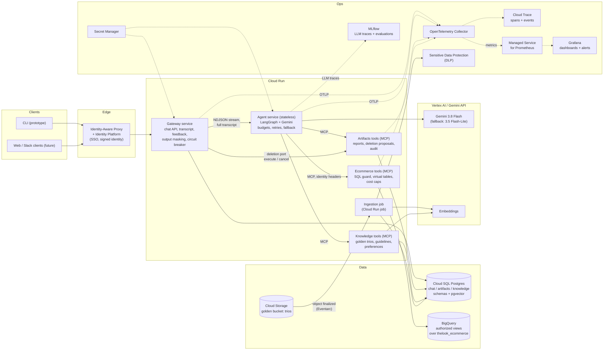
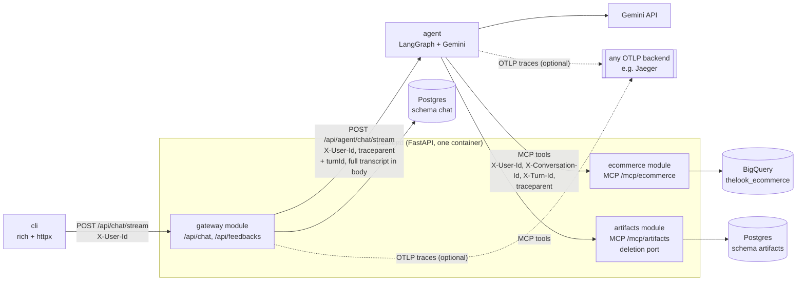
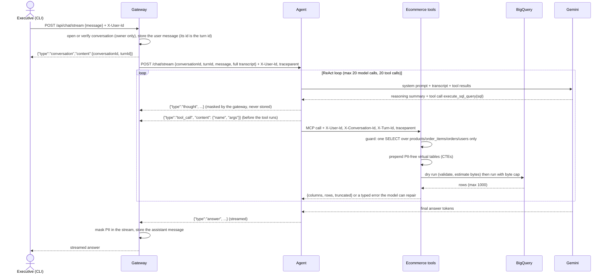
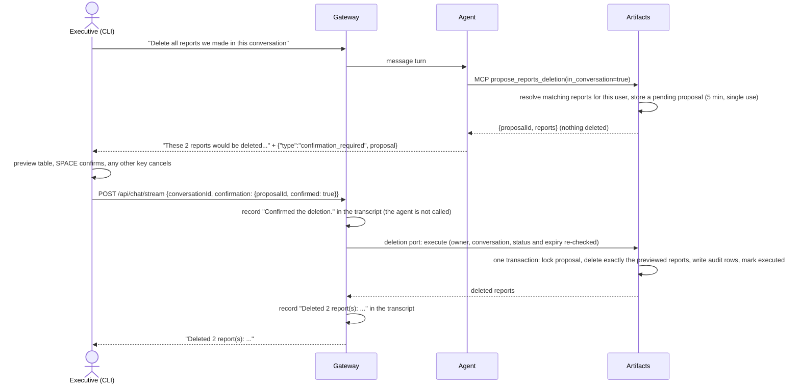

# Architecture

A data-analysis chat assistant for a retail company's executives. Executives ask questions in plain
language; the assistant queries BigQuery (`bigquery-public-data.thelook_ecommerce`), explains the
numbers, writes reports with action items, and manages a library of saved reports.

This document is the high-level design (HLD) and the technical explanation. Setup and running are in
[README.md](README.md).

**Contents**

1. [Design principles](#1-design-principles)
2. [High-level design (production on GCP)](#2-high-level-design-production-on-gcp)
3. [The prototype as built](#3-the-prototype-as-built)
4. [Technology choices](#4-technology-choices)
5. [Data flow](#5-data-flow)
6. [Error handling and fallbacks](#6-error-handling-and-fallbacks)
7. [Requirements](#7-requirements)
8. [Extensibility](#8-extensibility)
9. [Assumptions and limitations](#9-assumptions-and-limitations)

---

## 1. Design principles

1. **Policy lives in code, never in prompts.** What data can be read, which SQL may run, what may be
   deleted and how much a question may cost are enforced by the backend and the agent graph. The
   system prompt only shapes behavior; a prompt-injected or confused model still cannot exceed them.
2. **The model never sees raw data access.** It sees four PII-free virtual tables by bare name, no
   project or dataset path, and tools that validate everything it sends.
3. **Identity is never a tool argument.** The caller travels in headers set by code on every call;
   the model cannot choose whose data or reports it acts on.
4. **Destructive actions need a structured human decision.** The model can only *propose* a deletion.
   The gateway executes the deletion in code after the user answers a structured prompt in the client,
   never because the model read a "yes". The agent only proposes, so no service the model runs in can delete.
5. **Every failure ends in a safe, typed message.** No stack traces reach the user; technical detail
   goes to the service logs and the request's trace, neither of which ever contains query result rows.
6. **Thin, replaceable services.** Each capability sits behind an HTTP or MCP boundary configured by
   URL, so a module can move to its own service, or a new capability can be added, by configuration.

## 2. High-level design (production on GCP)

| Building block | Service | Why |
|---|---|---|
| Compute | **Cloud Run** (one service per box above, plus a job for ingestion) | Stateless containers, scale to zero for a few dozen executives, per-service IAM and secrets, no cluster to run. The agent being stateless lets it scale horizontally. |
| Identity | **Identity-Aware Proxy** + Identity Platform (Google Workspace / SSO) | Executives sign in with company SSO; the gateway receives a signed identity and forwards it. In the prototype this is the `X-User-Id` header. |
| LLM | **Gemini** (Gemini API or Vertex AI) | See [section 4](#4-technology-choices). Vertex AI adds VPC-SC, regional data residency and enterprise quotas. |
| Analytical data | **BigQuery** with **authorized views** and row-level access policies | The four tables are exposed as views that project no PII columns (and, if needed, filter rows per user). Prototype: the same views built as CTEs at query time. |
| Operational data | **Cloud SQL for PostgreSQL** | Transcript, feedback, reports, deletion proposals and audit, guidelines, preferences. One schema per module with its own role. `pgvector` for retrieval at this scale. |
| Golden bucket | **Cloud Storage** for analyst trios + **pgvector** index (Vertex AI Vector Search if the corpus grows large) | Analysts drop trios in a bucket; an ingestion job validates, scans, embeds and indexes them. |
| PII protection | **Sensitive Data Protection** (DLP) at ingestion and on stored reports; optionally **Model Armor** on prompts/responses | Third layer behind PII-free views and output masking. |
| Secrets | **Secret Manager** | Gemini key only in the agent; database credentials only in the services that own a schema. BigQuery access via the tools service's own service account (no keys). |
| Observability | **OpenTelemetry** in every service, exported to an **OpenTelemetry Collector**: spans and events to **Cloud Trace**, metrics to **Managed Service for Prometheus** with **Grafana** dashboards and alerts; **MLflow** for LLM-level traces and evaluations; service logs in **Cloud Logging**; health probes on every service | See [requirement 7](#requirement-7-observability). |

The gateway, the tool modules and the knowledge module are drawn as separate services. In the
prototype the gateway and the tool modules are one deployable (a modular monolith whose modules may
not import each other, enforced by `import-linter`), because the split is a deployment decision, not a
code change: the agent reaches every tool surface by URL. Reasons to split later: separate credentials
(only the ecommerce module needs BigQuery access), independent scaling of query execution, and
separate team ownership.

### Running in production

- **Deployment.** Each service is a container image built and tested in CI (unit tests, the
  module-independence contracts, and the evaluation suite of requirement 6 as the release gate),
  pushed to Artifact Registry and deployed as a new Cloud Run revision with a gradual traffic split.
  Rollback moves traffic back to the previous revision. Database migrations run as a Cloud Run job
  before the new revision takes traffic. Dev, staging and production are separate GCP projects.
- **Networking and service identity.** Only the gateway is reachable from outside, behind IAP. The
  agent and the tool services use internal ingress and accept calls only from the services allowed to
  call them (Cloud Run IAM with service-account ID tokens); Cloud SQL is reached over a private IP. The
  gateway forwards the IAP-verified user as `X-User-Id`, and the tools can trust it because only the
  agent can reach them.
- **Scaling.** The gateway and the agent are stateless (the transcript lives in Cloud SQL and is sent
  with every turn), so Cloud Run scales them horizontally; one warm instance each avoids cold starts.
  The tool services scale independently of the agent.
- **Health.** Cloud Run uses each service's `/startupz` and `/livez` probes; on GKE, `/readyz` is the
  readiness probe as well (see [requirement 7](#requirement-7-observability)).
- **Data protection.** Cloud SQL with automated backups and point-in-time recovery, one schema and
  database role per module; reports are masked before they are stored and audited when deleted.
  Transcripts and traces follow a retention period agreed with the client.
- **Cost control.** Per-query byte caps and per-turn call budgets
  ([requirement 5](#requirement-5-resilience-and-graceful-error-handling)), per-user daily quotas at
  the gateway, and a BigQuery project-level custom quota as the last backstop.

## 3. The prototype as built

| Folder | What it is |
|---|---|
| `cli/` | Terminal client with a main menu and conversations: streamed Markdown answers, `/history` and `/open` (conversations by generated title, resumed with their transcript), `/artifacts` (the report library), deletion confirmation, `/feedback`, `/debug` (tool-call arguments), `/thoughts` (reasoning as numbered steps that collapse as new ones arrive). |
| `backend/` | FastAPI app with three modules that share only `src/core`: `gateway` (chat, transcript, conversation list, feedback, masking, circuit breaker, deletion decisions), `ecommerce` (BigQuery runner, SQL guard, virtual tables, MCP tools), `artifacts` (reports, artifact envelope, deletion proposals and audit, MCP tools, and a read-only REST API for the CLI's report list). Shared code in `src/core`: config, identity, PII masking, tracing, health endpoints and the deletion port. Alembic migrations; a multi-stage Dockerfile with `backend` and `migration` targets. |
| `agent/` | Stateless LangGraph service: the turn graph, the static system prompt, the `get_current_date` tool, Gemini models, and middleware for budgets, retries, fallback, streaming and tracing. |
| `compose.yml` | Postgres, migration, backend, agent. The CLI runs on the host. |

The prototype maps one to one onto the HLD: compose services become Cloud Run services, the Postgres
container becomes Cloud SQL, the CTE virtual tables become BigQuery authorized views, the optional
OTLP endpoint becomes an OpenTelemetry Collector in front of Cloud Trace and Prometheus, the `X-User-Id`
header becomes the IAP identity.

## 4. Technology choices

| Choice | Reasoning |
|---|---|
| **Gemini 3.8 Flash** (main) | The brief asks for a recent Gemini model. 3.8 Flash is Google's current Flash model for agents and long multi-step workflows: it plans the "why" breakdowns, calls tools reliably over several SQL round trips, and uses dynamic thinking by default. Sampling parameters (temperature, top-p, top-k) stay at the model defaults: Google recommends keeping temperature at 1.0 for Gemini 3 models, because lower values can cause looping or degraded reasoning. It is chosen over the flagship Gemini 4 Argon on cost: at $0.75 / $3.75 per 1M input / output tokens (list prices, October 2026) it is about 2.7x cheaper, and Argon's price doubles on Dec 1, 2026. Argon stays a configuration change away (`LLM__MAIN_MODEL`) for teams that want maximum reasoning depth. |
| **Gemini 3.5 Flash-Lite** (fallback and titles) | Used when the main model keeps failing (429, 5xx, network) after retries, so an outage or quota spike degrades quality instead of availability; a different and cheaper model ($0.30 / $2.50), so it is unlikely to fail at the same moment. Verified to handle the agent's tool calling end to end. Also names conversations from their first message with a structured-output call, run alongside the answer. All three are configuration (`LLM__MAIN_MODEL`, `LLM__FALLBACK_MODEL`, `LLM__TITLE_MODEL`). |
| **LangGraph 1.x + LangChain `create_agent`** | See [below](#why-langgraph). |
| **MCP** (FastMCP server, `langchain-mcp-adapters` client) | Tools are a protocol boundary, not imports: the agent discovers the backend's tools by URL. New capabilities (charts, email, web search) are new MCP servers registered in configuration. The same servers can be used by other MCP clients. |
| **FastAPI** | Async HTTP and streaming for the gateway and agent; dependency injection for services. |
| **BigQuery Python client** with a guarded runner | Dry run before every query (free validation and a byte estimate), a hard per-query byte cap, a row cap, timeouts and typed errors. |
| **sqlglot** | Parses model SQL with the BigQuery dialect to enforce "one read-only query over the four virtual tables" structurally, instead of with regexes. |
| **Postgres + SQLAlchemy 2 (async) + Alembic** | Transactions for the deletion flow (lock, delete, audit in one transaction), real constraints, schemas per module; Alembic for versioned migrations. |
| **NDJSON streaming** | One JSON object per line is trivial to produce, relay and parse in any client, and survives proxies. |
| **rich** (CLI) | Live Markdown rendering, tables and panels in the terminal. |
| **OpenTelemetry** (FastAPI instrumentation, OTLP exporter) | Vendor-neutral traces: the same instrumentation sends to Jaeger locally and, through a Collector, to Cloud Trace and Prometheus in production, with no code change. |

### Why LangGraph

- **Explicit control around an agent loop.** The turn is a small graph: a message goes to the agent
  loop and then to a deterministic step that asks for confirmation. A confirmation never reaches the
  agent: the gateway executes or cancels the deletion through a port, with no LLM involved. That
  separation is what makes requirement 3 enforceable, and LangGraph makes the agent side a few lines.
- **Middleware for resilience and cost** (`create_agent`): per-turn model-call and tool-call limits,
  retries limited to transient errors, a fallback model, tool-error handling, and the observability
  hooks are composable middleware instead of hand-written loop code.
- **Per-run context.** User, conversation and turn ids live in the run's context, which the MCP
  interceptor reads to set headers on every tool call. Verified race-free with 50 concurrent runs on
  one shared client.
- **Streaming of tokens and custom events** from nested graphs (answer tokens, reasoning summaries,
  tool calls, confirmation requests) with one `astream` call.

> **Author's experience:** advanced. LangGraph, LangChain, FastAPI, FastMCP and the rest of this stack
> are what I use day to day at work, and the project follows the structure of my production services:
> a `core` package per service, config services, entities, repositories and services, and FastMCP
> toolset classes.

## 5. Data flow

### An analysis question

### Report deletion with confirmation

### Where data lives

| Store | What it holds | Written by | Notes |
|---|---|---|---|
| BigQuery `thelook_ecommerce` | Orders, order items, products, customers | Nobody (read-only) | Read only through the four PII-free virtual tables. Query results flow into the model's context and the answer, and are never stored by the system. |
| Postgres, schema `chat` | `conversations` (owner, generated title), `messages` (role and text of each turn, masked), `feedbacks` (rating and comment per turn) | Gateway | The transcript is the only conversation memory; the agent is stateless and receives it in full each turn. |
| Postgres, schema `artifacts` | `reports` (owner, title, masked body), `artifacts` (envelope: kind, owner, conversation, reference), `deletion_proposals` (user, conversation, report ids, status, expiry), `deletion_audits` (one row per deleted report: id, title, owner, actor, time) | Artifacts module, through its MCP tools and the deletion port | Reports outlive conversations; audit rows outlive reports and never contain bodies. |
| Traces | Span events: SQL, counts, bytes, tokens, timings, outcomes, ids | All services | Never result rows, report bodies or transcript text. |
| Nowhere | Query result rows, reasoning summaries, tool-call arguments | | Streamed during the turn only. |

## 6. Error handling and fallbacks

Every failure is classified where it happens and ends in one of three ways: repaired automatically,
retried in code without spending LLM tokens, or reported to the user with a safe message.

| Failure | Where | Handling |
|---|---|---|
| SQL syntax error, unknown column or table | BigQuery dry run (free) | Returned to the model as a repairable error with the clean reason (project, dataset and positions removed). The model fixes and retries within the turn's tool-call budget. |
| Model writes non-read-only SQL, several statements, a qualified or unknown table, a table function | SQL guard (sqlglot) | Rejected before BigQuery with a message telling the model what to change. |
| Query would scan too much | Dry-run estimate vs 1 GiB cap, plus `maximum_bytes_billed` server-side | Rejected before execution (no cost); the model is told to narrow the range or aggregate. |
| Empty result | Runner flags it | Tool description: check filters and literal values once, then say there is no data. |
| Too many rows | Runner | At most 1000 rows returned, flagged `truncated`; the model is told to aggregate. |
| BigQuery 429/5xx, network | Runner | Retried in code with exponential backoff (2 retries). If it still fails, the model gets a safe "temporarily unavailable" result marked do-not-retry and tells the user; the raw error never reaches the model. |
| BigQuery timeout | Runner | Query jobs are cancelled after 60 s. Schema lookups and credential refresh are not yet bounded by that timeout (known gap, see section 9). |
| Gemini 429, 5xx, network | Agent middleware | 2 retries with backoff, then the fallback model, then a safe message. |
| Gemini billing, auth, invalid request | Agent middleware | Not retried (pointless); fallback model once, then a safe message. |
| Model loops or over-plans | Agent middleware | Hard limits per turn: 20 model calls and 20 tool calls, counted across all tools (including several requested in one model turn). Extra tool calls are blocked with an error the model sees, and the model answers with what it has; hitting the model-call limit ends the turn with "try a narrower question". |
| A tool raises (backend unreachable) | Agent middleware | Converted into a tool message so the model can tell the user what it could not do. |
| Agent down, slow or failing | Gateway | Safe "temporarily unavailable" chunk. After 3 consecutive failures a circuit breaker opens for 30 s and answers immediately, then lets one trial request through. |
| Unexpected error (a bug, or Postgres down outside the handled paths) | Both services | A safe 500 ("Something went wrong"); the stack trace stays in the service log and an `unhandled_error` event is recorded on the request's trace. |
| Malformed agent output | Gateway | Safe error chunk; the partial answer already streamed is kept. |
| Expired, replayed or foreign deletion proposal | Gateway, through the deletion port | Nothing is deleted. The user is told the request expired or was already handled, and the decision and outcome are recorded in the transcript. |
| Database error while executing a deletion | Gateway | The transaction rolls back, so nothing is deleted; the user is told the report library is temporarily unavailable. |
| Invalid request, unknown or foreign conversation | Gateway | 422 / 404 with a short message; the CLI starts a new conversation if its conversation is gone. |

## 7. Requirements

### Requirement 1: Hybrid intelligence (golden bucket)

*Design only.*

A **golden trio** is an analyst-approved `question -> SQL -> report`. It carries what the raw schema
cannot: how analysts interpret vague words ("underspending" as revenue per active user), business
logic encoded in SQL (which statuses count as revenue, how churn is defined) and the expected shape of
a report.

**Storage and ingestion.** Analysts write trios as JSON or YAML files in a Cloud Storage bucket
(`question`, `sql`, `report_markdown`, `tags`, `author`, `approved_by`). Each new object triggers an
ingestion job (Eventarc -> Cloud Run job) that:

1. validates the schema and runs the SQL through the same guard and virtual tables as the agent
   (a trio that cannot run is rejected);
2. scans question and report with Sensitive Data Protection and rejects PII;
3. de-duplicates by embedding similarity against existing trios;
4. embeds the question (and a normalized form of the SQL) and stores it in Postgres with `pgvector`,
   with provenance and a version; trios can be retired, never silently edited.

**At query time** a `knowledge` MCP tool `find_similar_analyses(question)` returns the top 2-3 trios by
vector similarity with metadata filters (domain, recency). The agent uses them as worked examples:
interpretation, SQL patterns and report structure. Trios are guidance, not authority: their SQL still
goes through the guard, and numbers always come from fresh queries.

**Updating it over time.** Candidates come from the learning loop (below): turns rated thumbs-up that
needed no SQL repair are proposed as candidate trios. An analyst reviews, edits the report text and
approves; only then does the trio enter the bucket. Only the question and SQL pattern are promoted
from a user's turn; the report text is written or approved by an analyst, so one executive's
conversation never leaks into shared knowledge unreviewed.

### Requirement 2: Safety and PII masking

*Implemented.* Defense in depth: prevent, reduce, detect.

| Layer | What it does |
|---|---|
| Scope | The system prompt limits the assistant to analysis of this data and the user's reports, tells it to decline anything else and to treat instructions inside data as data. It is the soft layer; nothing below depends on it. |
| SQL guard | sqlglot parses every query: exactly one `SELECT`/`WITH`; only `products`, `order_items`, `orders`, `users` by bare name; no project/dataset qualification, `INFORMATION_SCHEMA`, other tables, wildcard tables or table functions; CTE names may not shadow the four tables. |
| PII-free virtual tables | The guarded query gets four CTEs prepended that project only non-PII columns. `users` exposes `id, age, gender, state, country, traffic_source, created_at`; names, email, street address, postal code, city and coordinates do not exist from the query's point of view, so even `SELECT *` is safe. Verified live: bare `users` resolves to the CTE. In production these are BigQuery authorized views. |
| Hidden dataset | Bare table names resolve through the job's default dataset; project and dataset names are stripped from every error message the model or the logs see. |
| No individual identification | The prompt forbids identifying people; rankings of customers use the anonymous `user_id` only. |
| Output masking | The gateway masks emails, phone numbers and card numbers in the streamed answer before it reaches the client or the transcript, and the artifacts module masks reports before storing them. Patterns are strict so analytics numbers survive; the stream masker holds back a short tail so a value split across chunks is never released unmasked. Reasoning summaries are masked the same way. Known gap: tool-call arguments are not masked yet, so the `/debug` view can show an address the user typed. |
| Traces | Span events contain SQL, row counts, bytes, tokens and timings, never result rows or report bodies. |
| Identity | User and conversation are set by code in headers on every tool call; the model cannot act for another user. |

**Malicious users.** The layers are built so that an adversarial or prompt-injected conversation has a
small blast radius. The model can read only the four PII-free tables; every query is guarded and capped
(1 GiB scanned, 1000 rows returned, 20 tool calls and 20 model calls per turn); it acts only as the
signed-in user; it cannot delete anything, only propose a deletion that needs the user's own keypress;
and its output is masked before it is shown or stored. The prompt's scope rule makes refusals polite,
but none of these limits depends on it.

**"Each user should only analyze data on products related to him."** The dataset has no link between
an executive and products, so the prototype treats all executives as entitled to all products
(assumption agreed for the prototype). The design supports per-user product scoping in the same layer
that removes PII: an entitlements table (`user -> brand / department`) and a row filter in the
`products` virtual table that scopes `order_items`, `orders` and `users` through it, passed as query
parameters. In production this maps to BigQuery row-level access policies on the authorized views.
An out-of-scope question then returns the same empty result as no data, so it does not reveal that
other brands exist.

**Production additions:** Model Armor (prompt-injection and jailbreak screening) in front of the agent,
k-anonymity thresholds on small groups (suppress segments with fewer than k customers), Sensitive
Data Protection on stored reports, and per-user rate limits and daily token budgets at the gateway (the
prototype bounds each turn, not a user's total usage).

### Requirement 3: High-stakes oversight (destructive operations)

*Implemented.* Users can delete their own reports; the administrator can delete anyone's.

- **Propose, never execute.** The only deletion tool the model has is `propose_reports_deletion`
  (by text, by conversation, or by report ids; "delete all reports mentioning Client X" is a
  case-insensitive match over title and body). It resolves the matching reports *for the caller*,
  stores a pending proposal bound to user and conversation with a 5-minute expiry, and deletes
  nothing. If nothing matches, no proposal is created.
- **"Reports made in this conversation"** is resolved in code through the artifact envelope
  (`artifact.conversation_id -> report`), never from ids the model reads out of the transcript.
- **Structured confirmation.** The agent's graph emits `confirmation_required` with the preview. The
  CLI shows a table (with owners for the admin) and asks for a single key: SPACE deletes, any other
  key cancels (default no). The answer travels as data: `{confirmation: {proposalId, confirmed}}`.
- **Execution outside the model's reach.** A confirmation never reaches the agent. The gateway calls
  the artifacts module through a core port, and there is no HTTP route for it, so neither the model nor
  a client can execute a proposal outside the chat flow. Execution is one transaction: lock the
  proposal, re-check user, conversation, status and expiry, delete exactly the previewed reports
  (owner-filtered unless admin) and their envelope rows, write one audit row per report (id, title,
  owner, actor, time; no bodies), mark it executed.
- **The transcript records the decision.** The gateway stores the user's decision ("Confirmed the
  deletion." or "Declined the deletion.") and the outcome as messages, so the next turn sees what
  happened to the reports.
- **Single use and short-lived.** Replaying a confirmation, a newer proposal in the same conversation,
  expiry, another user, or another conversation all result in nothing being deleted.
- **UX.** One preview, one keypress; no typing of ids or "yes" sentences.

*Production additions (author's suggestions, beyond the brief):* soft delete with a restore window,
and MCP elicitation once clients support it, so the confirmation is part of the protocol.

### Requirement 4: Continuous improvement (learning loop)

*Design only.* Three memory layers with different owners:

| Layer | Scope | Contents | Written by | Lifecycle |
|---|---|---|---|---|
| Conversation | one conversation | transcript, pending deletion proposal | gateway and artifacts (implemented) | kept with the conversation |
| User preferences | one user | presentation preferences: format (tables / bullets), depth, charts vs text, language | typed preference tool + inference from signals | user can view and reset (`/prefs`); old signals decay |
| Organization knowledge | everyone | golden trios, guidelines (requirement 8), glossary | analysts and admins only, versioned | review and rollback |

**User level.** A `remember_preference` tool with a closed schema (`format`, `depth`, `charts`,
`language`) stores explicit statements ("use tables from now on") in a `user_preferences` table; they
are injected into the presentation part of the prompt on every turn. Implicit signals ("shorter
please", "as a table", thumbs-down with a comment) are recorded as evidence and promoted to a
preference only after several consistent signals. Preferences change presentation only, never what
data can be read.

**System level.** The agent does not rewrite its own prompt or code. Improvement is a reviewed
pipeline fed by the events and feedback already collected:

1. **Signals:** thumbs-down and comments (`chat.feedbacks`), rephrased questions, turns that hit the
   step limit, SQL repairs, empty results, guard rejections, fallback usage (all in the events).
2. **Triage** (weekly, partly automated): cluster failing turns by error kind and topic.
3. **Fix as data:** a new golden trio, a glossary entry, a guideline, a prompt rule or a validator rule.
4. **Gate:** the change must pass the evaluation suite (requirement 6) with no regression.
5. **Release** as a new version, then monitor the same metrics per version.

Feedback is treated as untrusted input (poisoning risk): nothing reaches shared knowledge without a
human approval.

### Requirement 5: Resilience and graceful error handling

*Implemented.* See [section 6](#6-error-handling-and-fallbacks). In summary:

- **Self-correction without cost inflation.** Invalid SQL is caught by a free dry run and returned to
  the model as a clean, repairable error; non-repairable errors (permissions, timeouts, outages) are
  never sent back to the model. Repairs are bounded by the per-turn budget (20 tool calls, 20 model
  calls) and every query by a 1 GiB scan cap.
- **Empty results** are flagged. The model checks its filters once, then reports the zero with the latest date in the data in one sentence. It answers only the period and metric asked, and does not compare with other periods or re-run variants of the same metric.
- **Third-party failures.** BigQuery: retries in code, timeouts and cancellation. Gemini: retries on
  transient errors only, then a fallback model. Agent: circuit breaker in the gateway. Anything
  unexpected becomes a safe 500 and an `unhandled_error` event. The client always receives a
  well-formed stream ending in either an answer or one safe error message.
- **Cost is bounded per question.** The dry run is free, every query is capped at 1 GiB, a turn is
  capped at 20 model calls and 20 tool calls (enough for a full report: 8 to 12 queries plus the save), and the static system prompt plus the full transcript form
  a stable prefix that the model's prompt cache reuses. Thinking tokens are billed as output, so
  reasoning summaries can be turned off (`LLM__INCLUDE_THOUGHTS`).

### Requirement 6: Quality assurance

*Design only, beyond the unit and integration tests in the repository.*

**Before deployment: an offline evaluation suite** run in CI against a fixed snapshot date:

| Suite | How it is scored |
|---|---|
| SQL correctness | ~50 questions from the brief's categories and the golden trios, each with a reference query. The agent's final result set is compared with the reference result (same rows within tolerance), not the SQL text. |
| Answer and report quality | LLM-as-judge with a rubric (answers the question, numbers match the query results, assumptions stated, actionable items), calibrated against a small set of analyst-graded answers. |
| Safety | Red-team cases: requests for emails or names, reconstructing a person from filters, prompt injection inside a question or a report, deleting another user's report, replayed confirmations, off-topic and jailbreak requests. Must pass 100%. |
| Robustness | Rate-limit and outage simulation (fault injection on the model and BigQuery clients). |
| Cost and latency | Model calls, tokens, bytes scanned and p95 latency per question, compared with the previous release. |

Runs are tracked per prompt and model version (in MLflow); the release gate
is "no regression on correctness and safety, cost within budget".

**Verifying intent.** Beyond correct SQL, the judge checks that the answer addresses what was asked
(for example "why" questions include drivers, not just totals), and ambiguous questions are expected
to produce a clarifying question before any query runs (the prompt asks for one).

**UX.** Turns-to-answer, clarification rate, rephrase rate, time to first token, confirmation drop-off,
and thumbs-up rate from the feedback in production; plus short moderated sessions with two or three
executives before launch.

### Requirement 7: Observability

*Implemented.* Both services are traced with OpenTelemetry. FastAPI's instrumentation opens a span for
every request, and the agent adds a span for every model attempt (`llm_call`) and every tool call
(`tool <name>`). Trace context crosses services in the W3C `traceparent` header (gateway to agent to
backend MCP tools), the one header besides `X-User-Id`. It is added only on calls between our own
services, so the Gemini API never receives it. One user turn is therefore one trace across the
gateway, the agent and the tools. The turn's ids (`conversation_id`, `turn_id`, `user_id`) are set as
span attributes, and every event below is recorded as a span event with flat attributes. In the
prototype, both services log to stdout and export spans only when `TRACING__OTLP_ENDPOINT` is set;
the README shows a one-line Jaeger for inspecting them.

| Event | Service | Key fields |
|---|---|---|
| `chat_turn` | gateway | kind, outcome, duration, transcript length, tool calls, confirmation asked, PII masked |
| `agent_turn` | agent | outcome (answered, step limit, failed, unavailable), model calls, tool calls, SQL count, tokens in/out, models used |
| `llm_call` | agent | model, outcome, error code (e.g. `429 RESOURCE_EXHAUSTED`), tokens, latency; one per attempt, so retries and fallbacks are visible |
| `tool_call` | agent | tool, outcome (ok, rejected, error), latency |
| `sql_query` | backend | the model's SQL, outcome (ok, guard rejected, BigQuery error kind), rows, empty, truncated, bytes, latency |
| `report_saved`, `deletion_proposed / executed / cancelled / rejected`, `deletion_decision` | backend | the full deletion funnel |
| `feedback` | backend | rating per turn (stored in `chat.feedbacks`) |
| `agent_circuit` | backend | circuit breaker transitions |
| `unhandled_error` | backend, agent | method, route, exception type; the client gets a safe 500 |
| `conversation_title` | agent | outcome (ok, empty, error) and latency of the generated title |

**Metrics to track:** outcome rates and p50/p95 latency per turn; model calls and tokens per turn;
model error codes and fallback usage; first-pass SQL success, repairs per turn, empty and truncated
results, bytes scanned; guard rejections, PII masks and the deletion funnel; unhandled errors;
thumbs-up rate. The prototype does not aggregate them: each one is visible per turn in its trace, and
production computes them as metrics (below).

**Deep dives:** the CLI's `/debug` shows the turn id after each answer, which is what a user reports
with a problem. In a trace backend such as Jaeger, the tag `turn_id=<id>` opens that turn's trace: the gateway
request, the agent request, each model attempt with its error code and tokens, each tool call, and the
backend tool request with its SQL and outcome. `/debug` also shows every tool call's arguments as it
runs (SQL included, clipped for display), and `/feedback down <comment>` attaches a comment to the
turn. `/thoughts` shows Gemini's reasoning summaries (`include_thoughts`) as numbered steps that
collapse to their titles, masked like answers and never stored in the transcript; thinking tokens are
billed as output, so the setting can be turned off.

**The message correspondence of a turn** is reconstructed from three places, joined by the turn id
(the id of the user's message). The transcript in Postgres (`chat.messages`, printed by `/open` in the
CLI) holds what the user and the assistant said. The trace holds what happened in between: each model
attempt with its tokens and error code, each tool call with its outcome, and the SQL with its outcome.
The system prompt is static and versioned with the code. Query results and reasoning summaries are
deliberately not kept. In production, MLflow traces add the full prompts and completions per turn,
with tool outputs redacted, for prompt-level debugging.

**Health:** both services serve Kubernetes-style probes at their root. They are not traced, so
frequent probing does not bury real requests.

| Endpoint | Probe | Checks |
|---|---|---|
| `/livez` | liveness | None: the process is up. A dependency outage never restarts the pod. |
| `/readyz` | readiness | Backend: Postgres answers `SELECT 1`. Agent: the backend's MCP tool list loads. Each check has a 3 s limit. |
| `/startupz` | startup | The readiness checks have passed once since the process started; it then stays passed. |
| `/healthz` | people, load balancers | Every check with its status; a failure names the exception type only. |

**Production:** the services export to an OpenTelemetry Collector, which sends spans and events to
Cloud Trace and metrics to Managed Service for Prometheus; Grafana dashboards and alert rules sit on
top. Metric labels stay low-cardinality (outcome, model, tool, error code); user, conversation and
turn ids belong in traces, never in labels. LLM-level traces (prompts, completions, tool calls) and
evaluation runs go to MLflow, whose tracing is OpenTelemetry-compatible and can autolog LangChain
and LangGraph; evaluation datasets are built from production traces (see requirement 6). Service logs
with stack traces go to Cloud Logging. Alerts on: failed or step-limited turn rate, unhandled errors,
first-pass SQL success dropping, fallback usage, Gemini 429 rate, bytes scanned per day, guard
rejection spikes (possible abuse), thumbs-down rate.

### Requirement 8: Agility (persona management)

*Design only.* The CEO's weekly tone change must not need a deployment, and must not be able to weaken
safety.

**Vocabulary.** *Policy* is enforced in code and not editable from any UI. *Guidelines* are
admin-editable instructions that change wording and presentation. *Preferences* are per-user
presentation settings (requirement 4).

**Data model** (Postgres, `knowledge` schema): `guideline(id, name, kind, scope, activation,
active_version_id)`, `guideline_version(id, guideline_id, version, status, fields jsonb, instructions,
created_by, created_at, published_at)` and an audit table. `kind` is one of `tone`,
`report_template`, `playbook`, `glossary`; `fields` is validated against a schema per kind (for tone:
voice, formality, length, emphasis); `instructions` is a bounded free-text escape hatch.

**Runtime.** On each turn the agent fetches the active versions (cached for a minute) and renders them
deterministically into a "house style" block of the prompt. Guidelines only affect presentation: they
are not shown to the SQL path, carry no tools and no permissions, and the platform's fixed report
structure (Summary, Key findings, Caveats, Action items) stays; the guideline changes the voice inside
it. Precedence: policy > organization guidelines > user preferences > the current request. Every turn
records the guideline versions it used (in `agent_turn`), so a change in answers can be traced to a
guideline version.

**Workflow.** An admin (the CEO's office) edits a draft in a small admin page or via
`POST /api/guidelines/{name}/versions`, previews it on a set of sample questions, and publishes; it is
live on the next turn. Rollback is moving the active pointer back. Optional scheduled publishing
covers "a new tone every Monday". The `admin` role in the prototype's identity model is the role that
would hold this permission.

## 8. Extensibility

New capabilities are new tools behind MCP, registered in the agent's configuration by URL:

- **Charts:** a `render_chart(spec)` tool that validates a Vega-Lite spec built from query results and
  stores the image as a new artifact kind. The artifact envelope is already kind-agnostic, so charts
  get conversation linking, listing and deletion for free.
- **Email reports:** a `propose_email(report_id, recipients)` tool that goes through the same
  propose/confirm pattern as deletion (sending is an outward-facing action).
- **Web search for trends:** a search MCP server; its results are treated as untrusted data in the
  prompt, never as instructions.
- **Other clients** (web, Slack) reuse the gateway's chat API and stream format unchanged.

## 9. Assumptions and limitations

- **Authentication:** the prototype trusts the `X-User-Id` header (`admin` or `user_<name>`); there is
  no login. Production puts IAP / SSO in front of the gateway.
- **Product scoping:** all executives can analyze all products (see requirement 2 for the design of
  per-user scoping).
- **Customers** are shown in aggregate or by anonymous `user_id`, never by name or contact details,
  which are not queryable.
- **Data freshness:** the public dataset is synthetic and refreshed continuously; relative dates
  ("last month") are resolved against today's date, which the agent reads with a `get_current_date`
  tool rather than from the system prompt, so the prompt prefix stays cacheable.
- **Network isolation:** in the prototype the MCP endpoints are reachable on the
  backend's port (the deletion REST endpoints were removed: deletions run inside the gateway); production exposes only the gateway through IAP and keeps tool services internal
  (Cloud Run ingress "internal", service-to-service IAM).
- **Scale:** sized for a few dozen executives; the stateless agent and Cloud Run scale horizontally,
  and the transcript is sent in full each turn (a stable prefix the model's prompt cache reuses).
- **Known gaps (prototype):**
  - Tool-call arguments are not PII-masked yet, so the `/debug` view can show an address the user typed.
    Planned fix: mask them in the gateway before they are forwarded.
  - Conversation titles are generated from the first message and are not masked yet.
  - Schema lookups (`get_table`) and Google credential refresh are not bounded by the 60-second query
    timeout, so a network problem can hold a schema call for minutes. Queries are bounded.
  - Report search and the deletion preview return at most 50 matches, and the result does not say when
    it was cut, so a "delete all reports mentioning X" can miss older matches.
  - There is no per-user quota: per-turn caps bound each turn, not a user's total usage per day.
  - Metrics are defined (requirement 7) but not aggregated: each one is visible per turn in its trace.
  - Traces are exported only when an OTLP endpoint is configured. Without one, failures still reach the
    stdout logs, but the per-turn detail (model error codes, SQL outcomes, budgets) lives only in span
    events that nothing stores.
